# Henrique Ferro

### Infraestrutura de TI | Segurança da Informação | Segurança Ofensiva

*Explorando sistemas, identificando vulnerabilidades e desenvolvendo habilidades em segurança ofensiva.*

---

  

## `whoami`

Profissional de Infraestrutura de TI com experiência em ambientes Windows, Active Directory, segurança de endpoints, monitoramento e análise de eventos de segurança.

Atualmente direcionando minha carreira para **Segurança Ofensiva**, com foco em Pentest, Bug Bounty e avaliação de segurança em ambientes corporativos.

Acredito que compreender como os sistemas funcionam, identificar suas fragilidades e entender as técnicas utilizadas em ataques é fundamental para desenvolver uma visão sólida sobre segurança da informação.

---

## `technical_stack`

**Offensive Security**

**Infrastructure & Systems**

**Security & Monitoring**

---

## `areas_of_interest`

- Active Directory Security
- Network & Service Enumeration
- Web Application Security
- Windows & Linux Privilege Escalation
- Exploitation & Post-Exploitation
- Vulnerability Research
- Bug Bounty
- Penetration Testing

---

## `labs_and_research`

Aprendizado baseado em prática, laboratórios controlados e pesquisas independentes.

- **Active Directory:** enumeração, análise de permissões, relacionamentos e exploração.
- **Windows & Linux:** enumeração e escalonamento de privilégios.
- **Web Security:** reconhecimento, análise de aplicações e identificação de vulnerabilidades.
- **Reconnaissance:** mapeamento de superfície de ataque e enumeração de serviços.
- **Security Research:** experimentos, projetos e documentação técnica.

Meus estudos e experimentos são documentados nos repositórios deste GitHub.

---

## `learning_platforms`

---

## `connect`

---

`root@henrique:~$ echo "Keep learning. Keep exploring."`

**[ END OF TRANSMISSION ]**

